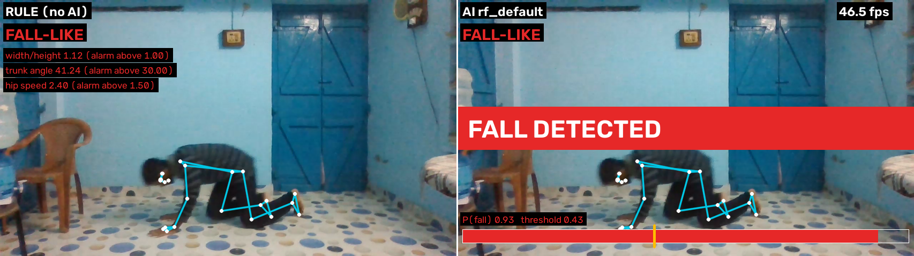

# AI Fall Detection from Camera: Report

CSC340 Artificial Intelligence group project, SIT KMUTT. Presentation: Tue 24 Nov 2026.

| Student ID | Name |
| --- | --- |
| 67130500802 | Kraiwich Jaiton |
| 67130500840 | Theerawat Patthawee |
| 67130500841 | Benyapon Saisong |
| 67130500853 | Napat Chang-Ekwong |

Every number in this report is read from a file in `results/tables/`. File names are given next to each table. Settings are read from `config.yaml`.

## 1. Summary

- Task: binary classification of a 2 second video window as Fall (1) or Not fall (0) from MediaPipe body pose.
- RQ1: a Random Forest on pose features beats the rule based method (no AI). Cross validation window recall 0.917 against 0.745, F1 0.851 against 0.786. Unseen CAUCAFall clips: recall 0.800 against 0.620, F1 0.851 against 0.705, exact McNemar p = 0.004.
- RQ2: Random Forest has the best cross validation F1 (0.851) among models that reach recall 0.90. SVM tuned 0.823, LSTM default 0.737, Naive Bayes 0.724.
- Goals: F1 above the rule met, 15 fps met, live demo built, recall 0.90 met in cross validation and not met on the unseen test (0.694 per window, 0.800 per clip).

## 2. Problem, questions and goals

Thailand is an aged society. An older person who falls at home alone can lie on the floor for hours before help arrives. Wearable sensors work only when worn. Camera methods based on fixed rules confuse lying down with falling.

| Item | Statement |
| --- | --- |
| RQ1 | Does an ML classifier on body pose features beat a rule based method (no AI) on recall and F1? |
| RQ2 | Which of Naive Bayes, Random Forest, SVM (RBF) and LSTM performs best? |
| Goal 1 | Fall recall at least 0.90 |
| Goal 2 | F1 above the rule baseline on the same data |
| Goal 3 | At least 15 fps on a laptop |
| Goal 4 | A working live demo |

Recall comes first because a missed fall costs more than a false alarm.

## 3. Team and responsibilities

The group has no leader. All four members contribute and present.

| Role | Members |
| --- | --- |
| Data (labels, pose extraction) | Napat Chang-Ekwong |
| GMDCSA-24 hand annotation | Theerawat Patthawee (tool `tools/annotate_falls.py`), Napat Chang-Ekwong |
| Features and rule baseline | Napat Chang-Ekwong, Benyapon Saisong |
| Modelling and evaluation | Kraiwich Jaiton, Napat Chang-Ekwong, Theerawat Patthawee |
| Live demo | Benyapon Saisong, Napat Chang-Ekwong |
| Result tables and figures | Whole group |
| Presentation | Everyone |

## 4. Data

Source: `dataset_summary.csv`.

| Dataset | Role | Clips | Fall clips | Non fall clips | People | fps | Clips with windows | Windows | Fall windows |
| --- | --- | --- | --- | --- | --- | --- | --- | --- | --- |
| URFD | Training | 70 | 30 | 40 | not given | 30 | 67 | 445 | 65 |
| GMDCSA-24 | Training | 160 | 79 | 81 | 4 | 14.951 to 29.925 | 160 | 1,722 | 284 |
| CAUCAFall | Unseen test | 100 | 50 | 50 | 10 | 20 | 99 | 1,371 | 173 |

Training totals: 230 clips, 2,167 windows, 349 fall windows.

### 4.1 Labels

- `data/labels.csv` holds one row per clip: `clip_id, dataset, subject, fps, fall_start_s, fall_end_s, activity`.
- URFD: the falling interval is the run of frames labelled 0 (falling) in the URFD frame annotation.
- GMDCSA-24: the dataset gives no fall times. Theerawat Patthawee and Napat Chang-Ekwong marked the start and end of all 79 falls by hand with `tools/annotate_falls.py`. Times are stored in `data/annotations/gmdcsa24_fall_times.csv`.
- CAUCAFall: frames are marked fall only once the body is on the ground. The first such frame is the onset. The falling interval is onset minus 1.0 s to onset plus 0.5 s.

### 4.2 Window label

| Coverage of the falling interval | Label |
| --- | --- |
| At least 0.5 | 1 (Fall) |
| More than 0 and less than 0.5 | Dropped |
| 0 (including lying after the fall) | 0 (Not fall) |

### 4.3 Windowless clips

- URFD: 3 fall clips (fall 16, 21, 22) have no window because they last 1.80 to 1.83 s, shorter than one 2 s window (`clips_without_windows.csv`).
- CAUCAFall: s8 fall forward has no detected pose in any frame, so it has no window. It counts as a missed fall.

## 5. Preparation pipeline

| Step | Setting |
| --- | --- |
| Pose | MediaPipe 1.2.3 Tasks `PoseLandmarker`, full model, `RunningMode.VIDEO`, one person, 33 landmarks |
| Visibility | x and y set to NaN where landmark visibility is below 0.5 |
| Cache | `data/keypoints/<clip_id>.npz` with `t`, `kp` (T, 33, 3) and `fps` |
| Resample | 15 Hz time grid with linear interpolation, gaps up to 0.3 s filled |
| Window | 2.0 s long, start every 0.5 s, 30 frames per window |
| Missing pose | A window with more than 30% of frames without a pose is not classified |
| Normalization | Centered on the median hip midpoint, scaled by the median torso length of the window |
| Groups | Every window keeps its `clip_id` as the group key for all splits |

Scripts: `scripts/01_labels.py`, `scripts/02_extract_pose.py`, `scripts/03_build_windows.py`.

## 6. Features

### 6.1 Window features (39)

Seven body quantities are computed per frame from the normalized skeleton.

| Quantity | Definition |
| --- | --- |
| `trunk_angle` | Angle of the hip to shoulder line from vertical, degrees |
| `trunk_ang_vel` | Rate of change of `trunk_angle` |
| `hip_down_speed` | Downward speed of the hip midpoint, torso lengths per second |
| `hip_down_accel` | Rate of change of `hip_down_speed` |
| `head_hip_gap` | Vertical gap from head to hip |
| `hip_ankle_gap` | Vertical gap from hip to ankles |
| `bbox_ratio` | Width over height of the box around all visible landmarks |

Each quantity gives min, max, mean, std and range over the window (35 features). `trunk_angle`, `head_hip_gap`, `hip_ankle_gap` and `bbox_ratio` also give `last`, the mean over the final 0.5 s (4 features). Total: 39 features in `data/features/windows.parquet`.

### 6.2 Sequences for the LSTM

`data/features/sequences.npz` holds X with shape (N, 30, 24): 30 frames by the normalized x and y of 12 joints (shoulders, elbows, wrists, hips, knees, ankles).

The training pipeline and the live demo use the same pose model file and the same feature code (`src/features.py`, `src/windows.py`).

## 7. Rule baseline (no AI)

Based on Chen et al. (2020). A window is a fall when all three checks are true.

| Check | Feature | Published threshold | Tuned threshold |
| --- | --- | --- | --- |
| Body wider than tall | `bbox_ratio_last` | above 1.0 | above 1.0 |
| Trunk tilted | `trunk_angle_last` | above 45 degrees | above 30 degrees |
| Hips drop fast | `hip_down_speed_max` | above 1.0 torso lengths per second | above 1.5 |

- The hip speed of 1.0 is the project default. The source gives no value in these units.
- Tuning: grid search inside each training fold, maximizing F1. Grid: ratio 0.6, 0.8, 1.0, 1.2, 1.5, 2.0. Angle 30, 45, 60, 75 degrees. Speed 0.5, 1.0, 1.5, 2.0, 3.0, 4.0.
- Both the published and the tuned rule are reported. The tuned values above are the frozen rule refit on all training windows (`caucafall_results.csv`).

## 8. Models

| Model | Pipeline | Grid (inner search) |
| --- | --- | --- |
| Naive Bayes | median imputer, GaussianNB | `var_smoothing` 1e-9, 1e-6, 1e-3, 1e-1 |
| Random Forest | median imputer, 300 trees, `class_weight="balanced"` | `max_depth` none, 5, 10. `min_samples_leaf` 1, 3, 10 |
| SVM (RBF) | median imputer, standard scaler, `class_weight="balanced"` | `C` 0.1, 1, 10, 100. `gamma` scale, 0.01, 0.1 |
| LSTM | one LSTM layer, dropout 0.3, sigmoid output, Adam 0.001 | units 16, 32, 64 (default 32) |

- Imputer, scaler and model sit in one scikit-learn `Pipeline`. Nothing is fitted on a test fold.
- LSTM (Keras 3 on Colab, `notebooks/lstm_colab.ipynb`): up to 80 epochs, early stopping with patience 8 on a validation split of whole clips (4 group splits), batch 32, class weights. Augmentation on the fitting part only: horizontal flip with left and right joints swapped, plus Gaussian noise with std 0.02. One seed.
- No SMOTE. Seeds are fixed from `config.yaml` (seed 0).

## 9. Evaluation protocol

| Item | Setting |
| --- | --- |
| Outer loop | `StratifiedGroupKFold(5)`, shuffled, seed 0, groups are `clip_id` |
| Inner loop | `GridSearchCV` with `GroupKFold(3)`, groups are `clip_id`, scoring F1 |
| Threshold | Highest threshold that keeps recall at or above 0.90 on out of fold training predictions, then frozen |
| Metrics | Recall, precision, specificity, F1, accuracy, mean with min and max over 5 folds |
| Levels | Window level, and clip level (a clip is predicted fall when any of its windows is predicted fall) |
| Before and after tuning | Every model has a default row and a tuned row |
| Model choice | Highest cross validation F1 among models whose mean recall reaches 0.90 |
| Unseen test | CAUCAFall, run once after every model was frozen. Never used for training, tuning, threshold choice, feature design or model choice |
| Significance | Exact McNemar test (binomial) on clip level predictions |

Scripts: `scripts/04_cross_validate.py`, `scripts/05_test_caucafall.py` (run once on 2026-11-21), `scripts/06_cv_report.py`, `scripts/07_test_report.py`.

## 10. Cross validation results

### 10.1 Window level, mean (min to max) over 5 folds

Sources: `tuning_before_after.csv`, `lstm_summary.csv`.

| Detector | Recall | Precision | Specificity | F1 | Accuracy |
| --- | --- | --- | --- | --- | --- |
| Rule, published | 0.754 (0.690 to 0.786) | 0.751 | 0.950 | 0.751 (0.705 to 0.840) | 0.919 |
| Rule, tuned | 0.745 (0.662 to 0.829) | 0.834 | 0.971 | 0.786 (0.723 to 0.885) | 0.934 |
| Naive Bayes, default | 0.897 (0.789 to 0.940) | 0.608 | 0.888 | 0.724 (0.671 to 0.797) | 0.889 |
| Naive Bayes, tuned | 0.897 (0.789 to 0.940) | 0.608 | 0.888 | 0.724 (0.671 to 0.797) | 0.889 |
| Random Forest, default | 0.917 (0.829 to 0.972) | 0.795 | 0.954 | 0.851 (0.816 to 0.883) | 0.948 |
| Random Forest, tuned | 0.917 (0.829 to 0.972) | 0.795 | 0.954 | 0.851 (0.816 to 0.883) | 0.948 |
| SVM, default | 0.918 (0.803 to 0.985) | 0.724 | 0.932 | 0.808 (0.760 to 0.840) | 0.930 |
| SVM, tuned | 0.909 (0.817 to 0.985) | 0.756 | 0.943 | 0.823 (0.784 to 0.850) | 0.937 |
| LSTM, default | 0.895 (0.786 to 0.985) | 0.636 | 0.896 | 0.737 (0.684 to 0.767) | 0.896 |
| LSTM, tuned | 0.881 (0.700 to 0.985) | 0.634 | 0.896 | 0.728 (0.684 to 0.802) | 0.893 |

### 10.2 Clip level, mean over 5 folds

| Detector | Recall | Precision | F1 | Pooled recall, windowless falls counted as missed | Pooled F1, same |
| --- | --- | --- | --- | --- | --- |
| Rule, published | 0.876 | 0.829 | 0.851 | 0.853 | 0.842 |
| Rule, tuned | 0.856 | 0.848 | 0.852 | 0.835 | 0.843 |
| Naive Bayes | 0.981 | 0.694 | 0.813 | 0.954 | 0.803 |
| Random Forest | 0.980 | 0.791 | 0.875 | 0.954 | 0.863 |
| SVM, default | 0.980 | 0.762 | 0.856 | 0.954 | 0.846 |
| SVM, tuned | 0.952 | 0.752 | 0.839 | 0.927 | 0.828 |
| LSTM, default | 0.990 | 0.726 | 0.838 | not computed | not computed |
| LSTM, tuned | 0.981 | 0.758 | 0.854 | not computed | not computed |

### 10.3 Effect of fine tuning (window F1)

| Detector | Before | After |
| --- | --- | --- |
| Rule | 0.751 | 0.786 |
| SVM | 0.808 | 0.823 |
| Random Forest | 0.851 | 0.851 (identical, default kept) |
| Naive Bayes | 0.724 | 0.724 (identical) |
| LSTM | 0.737 | 0.728 |

### 10.4 Model choice

Source: `model_selection.csv`. Random Forest default is chosen: highest F1 (0.851) among models reaching recall 0.90. Naive Bayes (0.897) and both LSTM variants do not reach the recall target. The chosen model is saved in `models/best.joblib` with threshold 0.43, the tuned rule in `models/rule.joblib`.

### 10.5 Pooled confusion counts and average precision

Source: `cv_pooled_metrics.csv`. Out of fold windows pooled over the 5 folds, 2,167 windows, 349 falls.

| Detector | TP | FP | TN | FN | Average precision |
| --- | --- | --- | --- | --- | --- |
| Rule, published | 263 | 90 | 1,728 | 86 | not applicable |
| Rule, tuned | 260 | 53 | 1,765 | 89 | not applicable |
| Naive Bayes | 313 | 204 | 1,614 | 36 | 0.708 |
| Random Forest | 320 | 83 | 1,735 | 29 | 0.944 |
| SVM, tuned | 317 | 104 | 1,714 | 32 | 0.933 |

Figures: `results/figures/confusion_matrices_cv.png`, `results/figures/pr_curves_cv.png`.

### 10.6 Detection delay in cross validation

Source: `cv_detection_delay_summary.csv`. Time from the annotated fall start to the end of the first positive window, 106 fall clips.

| Detector | Detected | Median delay (s) | 90th percentile (s) | Max (s) |
| --- | --- | --- | --- | --- |
| Rule, published | 92 | 1.343 | 1.908 | 2.505 |
| Rule, tuned | 91 | 1.309 | 1.759 | 2.505 |
| Naive Bayes | 104 | 1.257 | 1.879 | 2.904 |
| Random Forest | 103 | 1.200 | 1.721 | 2.505 |
| SVM, tuned | 101 | 1.200 | 1.832 | 2.904 |

## 11. Unseen test on CAUCAFall

Source: `caucafall_results.csv`. Frozen thresholds: Random Forest 0.43. Rule tuned (ratio 1.0, angle 30, speed 1.5). Rule published (ratio 1.0, angle 45, speed 1.0).

| Detector | Level | Recall | Precision | Specificity | F1 | Accuracy | TP | FP | TN | FN |
| --- | --- | --- | --- | --- | --- | --- | --- | --- | --- | --- |
| Random Forest | window | 0.694 | 0.889 | 0.987 | 0.779 | 0.950 | 120 | 15 | 1,183 | 53 |
| Random Forest | clip | 0.800 | 0.909 | 0.920 | 0.851 | 0.860 | 40 | 4 | 46 | 10 |
| Rule, tuned | window | 0.445 | 0.875 | 0.991 | 0.590 | 0.922 | 77 | 11 | 1,187 | 96 |
| Rule, tuned | clip | 0.620 | 0.816 | 0.860 | 0.705 | 0.740 | 31 | 7 | 43 | 19 |
| Rule, published | window | 0.480 | 0.856 | 0.988 | 0.615 | 0.924 | 83 | 14 | 1,184 | 90 |
| Rule, published | clip | 0.660 | 0.805 | 0.840 | 0.725 | 0.750 | 33 | 8 | 42 | 17 |

### 11.1 McNemar test

Source: `caucafall_mcnemar.csv`. Clip level, 100 clips, Random Forest against the tuned rule.

| Both correct | Only Random Forest correct | Only rule correct | Both wrong | Exact p |
| --- | --- | --- | --- | --- |
| 72 | 14 | 2 | 12 | 0.004 |

### 11.2 Random Forest errors on CAUCAFall

Source: `caucafall_clip_predictions.csv`.

| Error | Clips |
| --- | --- |
| Missed falls (10) | s3 fall forward, s3 fall sitting, s4 fall forward, s4 fall right, s4 fall sitting, s7 fall sitting, s8 fall forward, s8 fall left, s10 fall forward, s10 fall sitting |
| False alarms (4) | s3 sit down, s8 kneel, s9 sit down, s10 sit down |

- 4 of the misses are forward falls and 4 are falls to sitting.
- s8 fall forward has no detected pose. s3 fall forward has no window covering the fall. Both fail before the model.
- The recall drop from cross validation (0.917 to 0.694 per window, 0.954 to 0.800 per clip with windowless falls counted as missed) shows that grouped cross validation on URFD and GMDCSA-24 overestimates performance on a new camera and new people. The threshold was not changed after the test.

Figures: `results/figures/caucafall_confusion_clip.png`, `results/figures/caucafall_confusion_window.png`.

## 12. Error analysis on training data

### 12.1 Feature importance

Source: `rf_feature_importance.csv`. Mean decrease in Gini impurity, Random Forest refit on all training windows. Top 10:

| Rank | Feature | Importance |
| --- | --- | --- |
| 1 | `bbox_ratio_range` | 0.126 |
| 2 | `trunk_ang_vel_max` | 0.116 |
| 3 | `bbox_ratio_std` | 0.077 |
| 4 | `hip_down_speed_max` | 0.070 |
| 5 | `trunk_ang_vel_mean` | 0.066 |
| 6 | `head_hip_gap_last` | 0.047 |
| 7 | `bbox_ratio_max` | 0.046 |
| 8 | `bbox_ratio_last` | 0.041 |
| 9 | `trunk_angle_max` | 0.039 |
| 10 | `trunk_ang_vel_range` | 0.039 |

Body shape change and trunk rotation carry the most weight. Figure: `results/figures/rf_feature_importance.png`.

### 12.2 Alarms on normal activities

Source: `activity_alarm_rates.csv`. Out of fold predictions on non fall clips.

| Dataset | Non fall clips | Rule tuned, clips alarmed | Random Forest, clips alarmed |
| --- | --- | --- | --- |
| GMDCSA-24 | 81 | 4 | 14 |
| URFD | 40 | 12 | 14 |

7 of the 14 GMDCSA-24 clips alarmed by Random Forest are lying down or sleeping activities. Lying down ends with the body horizontal, as after a fall.

### 12.3 Threshold trade off

Source: `cv_threshold_tradeoff.csv`. Random Forest, one pooled threshold over all out of fold training scores. No other threshold was tried on CAUCAFall.

| Recall target | Threshold | Window recall | False windows | Fall clips found (of 106) | Normal clips alarmed (of 121) |
| --- | --- | --- | --- | --- | --- |
| 0.90 | 0.44 | 0.903 | 59 | 104 | 24 |
| 0.95 | 0.257 | 0.951 | 156 | 105 | 40 |
| 0.98 | 0.117 | 0.983 | 368 | 106 | 70 |

The pooled threshold 0.44 differs from the frozen threshold 0.43, which was chosen on all training data in a separate step.

## 13. Live demo system

`python -m src.demo --source 0` runs in one OpenCV window with no network.

| Stage | Behaviour |
| --- | --- |
| Input | Webcam index or video file through `--source` |
| Pose | Same PoseLandmarker model file as training |
| Buffer | Last 2.0 s of keypoints, same window and feature code as training |
| Scoring | Every 0.2 s, rule on the left panel and Random Forest on the right panel for the same frame |
| Alert | 2 positive checks in a row, then 10 s cooldown. Banner, 880 Hz beep (AI panel), line in `logs/alerts.csv` |
| Privacy | `--privacy` draws the skeleton on a black frame |

| Reliability state | Behaviour |
| --- | --- |
| NO PERSON | Shown when no usable pose is found. Never a silent safe state |
| RULE FALLBACK | The rule keeps running when `models/best.joblib` fails to load |
| CAMERA OFFLINE | Shown when frames stop. The loop restarts with backoff from 1 s up to 30 s |
| Logs | Alerts in `logs/alerts.csv`, errors in `logs/errors.log` |

### 13.1 Speed

Source: `fps.csv`. Windows laptop with an Intel CPU (Family 6 Model 158), full pose model, two GMDCSA-24 videos (Subject 1 ADL 01, 245 frames, and Subject 1 Fall 05, 174 frames).

| Date | Detector | Video | Pose only fps | Pose plus detector fps | Window scoring (ms) |
| --- | --- | --- | --- | --- | --- |
| 2026-11-20 | Random Forest | ADL 01 | 57.4 | 46.2 | not recorded |
| 2026-11-20 | Random Forest | Fall 05 | 59.1 | 47.2 | not recorded |
| 2026-11-21 | Random Forest | ADL 01 | 34.2 | 27.3 | 24.036 |
| 2026-11-21 | Random Forest | Fall 05 | 48.6 | 45.6 | 17.413 |
| 2026-11-21 | Random Forest | ADL 01 | 49.2 | 40.9 | 18.409 |
| 2026-11-21 | Rule, tuned | ADL 01 | 60.6 | 45.9 | 0.467 |
| 2026-11-21 | Rule, tuned | Fall 05 | 59.5 | 48.6 | 0.432 |
| 2026-11-21 | Naive Bayes | ADL 01 | 50.1 | 48.3 | 1.630 |
| 2026-11-21 | Naive Bayes | Fall 05 | 55.7 | 48.3 | 1.617 |
| 2026-11-21 | SVM, default | ADL 01 | 51.4 | 45.0 | 2.072 |
| 2026-11-21 | SVM, default | Fall 05 | 54.4 | 40.6 | 2.177 |

Every run is above the 15 fps goal. The slowest run (27.3 fps) also has the slowest pose only rate (34.2 fps), so the machine was slower during that run. LSTM speed was not measured (Colab only). Webcam fps is shown live on screen and is not saved to a table.

### 13.2 End to end alert latency

Source: `alert_latency_summary.csv`. The demo loop replayed on the 79 GMDCSA-24 fall videos. These videos are training data, so the numbers are optimistic (in sample).

| Detector | Fall videos | Alerted | Median latency from fall start (s) | 90th percentile (s) | Max (s) |
| --- | --- | --- | --- | --- | --- |
| Random Forest | 79 | 78 | 1.003 | 1.781 | 2.932 |
| Rule, tuned | 79 | 66 | 1.227 | 2.058 | 2.798 |

No alert fired before a fall started.

### 13.3 Demo test run

Run of 2026-11-20 on the same laptop, GMDCSA-24 Subject 1 Fall 05 played through `python -m src.demo --source <video>`. This video is training data, so the run shows the product working, not its accuracy. Source: `logs/alerts.csv`.

| Panel | Detector | Alert at (s into the video) | Score | Threshold | Beep |
| --- | --- | --- | --- | --- | --- |
| AI | Random Forest | 2.424 | 0.93 | 0.43 | yes |
| Rule | Rule, tuned | 2.626 | 1.0 | 0.5 | no |

With the model file removed, the RULE FALLBACK run alerted on both panels at 2.626 s with the tuned rule.

Screenshots of the demo window from this run, in `docs/screenshots/`:

| File | Shows |
| --- | --- |
| `demo_alert_fall05.png` | Rule and AI panels at the AI alert, FALL DETECTED, P(fall) 0.93, 46.5 fps |
| `demo_privacy.png` | The same alert in privacy mode, skeleton on a black frame |
| `demo_rule_fallback.png` | RULE FALLBACK with the AI model file not loaded, FALL DETECTED by the rule |
| `demo_no_person.png` | NO PERSON on a clip with nobody in view |
| `demo_lying_calm.png` | GMDCSA-24 Subject 1 ADL 01, lying on a bed, AI calm at P(fall) 0.28 |



## 14. Goals

| Goal | Result | Status |
| --- | --- | --- |
| Recall at least 0.90 | CV 0.917. CAUCAFall 0.694 per window, 0.800 per clip | Met in CV, not met on unseen data |
| F1 above the rule | CV 0.851 against 0.786. CAUCAFall clip 0.851 against 0.705 | Met |
| At least 15 fps | 27.3 to 47.2 fps with Random Forest across 5 runs | Met |
| Live demo | Built, with fallback, NO PERSON state, privacy mode and logs | Met |

## 15. Limits

- Falls are acted by young volunteers, not older people.
- 230 training clips.
- One person in view only.
- Folds are grouped by clip, not by person, because URFD gives no person IDs. One GMDCSA-24 person can be in both training and test folds, so cross validation is optimistic.
- One annotator per GMDCSA-24 clip, with no agreement check.
- The LSTM ran with one seed and was not tested on CAUCAFall.
- Alert latency was measured on training videos.
- Real home use needs consent under PDPA. URFD is not licensed for commercial use.
- The system is not ready to protect a real person: unseen clip recall is 0.800.

## 16. Deployment

Built: one laptop, one camera, everything local. Proposed and not built: one small box per home running the same loop, sending only alert events and never video. Options are compared in `docs/deployment-options.md`.

## 17. Reproduce

```text
python -m venv .venv
pip install -r requirements.lock.txt
python scripts/01_labels.py
python scripts/02_extract_pose.py
python scripts/03_build_windows.py
python scripts/04_cross_validate.py
python scripts/06_cv_report.py
python scripts/07_test_report.py
python scripts/08_alert_latency.py
python -m src.demo --source 0 --privacy
```

`scripts/05_test_caucafall.py` already ran once on 2026-11-21 and refuses to run again. The LSTM runs in Google Colab with `notebooks/lstm_colab.ipynb`. The pose model file `models/pose_landmarker_full.task` is downloaded from the MediaPipe guide.

## 18. Files

| Path | Content |
| --- | --- |
| `config.yaml` | Every setting |
| `src/` | labels, pose, windows, features, baseline, models, evaluate, report, demo |
| `scripts/` | Thin wrappers that run one step each |
| `notebooks/lstm_colab.ipynb` | LSTM cross validation |
| `tools/annotate_falls.py` | GMDCSA-24 fall time annotation tool |
| `models/` | Frozen Random Forest and rule |
| `results/tables/` | Every number in this report |
| `results/figures/` | Every chart |
| `docs/slides.md` | Slide content, speaker notes and Q&A |
| `docs/screenshots/` | Demo window screenshots from the 2026-11-20 test run |
| `docs/deployment-options.md` | Deployment options (slide only) |
